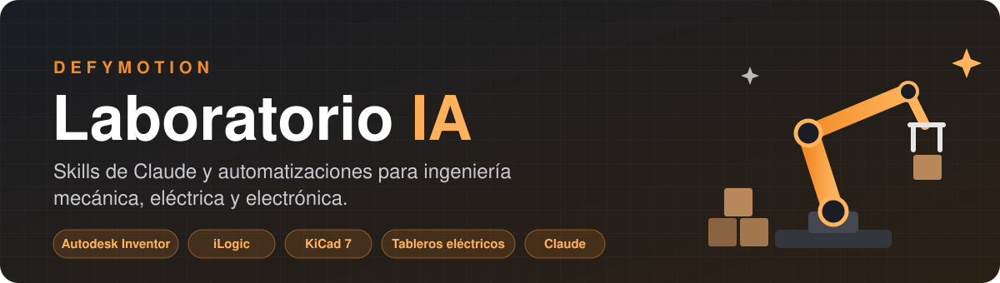
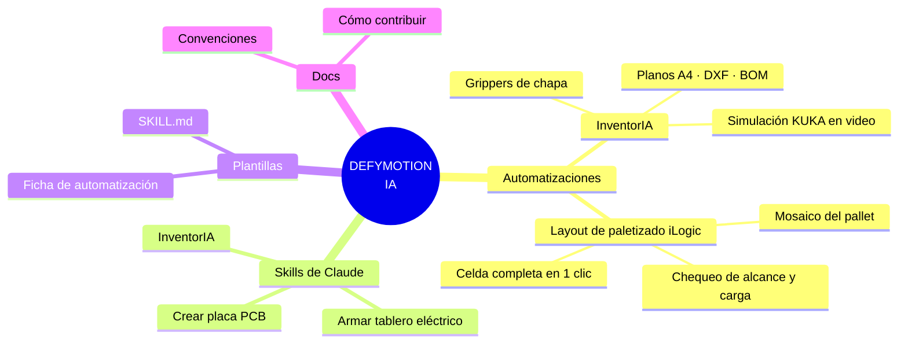
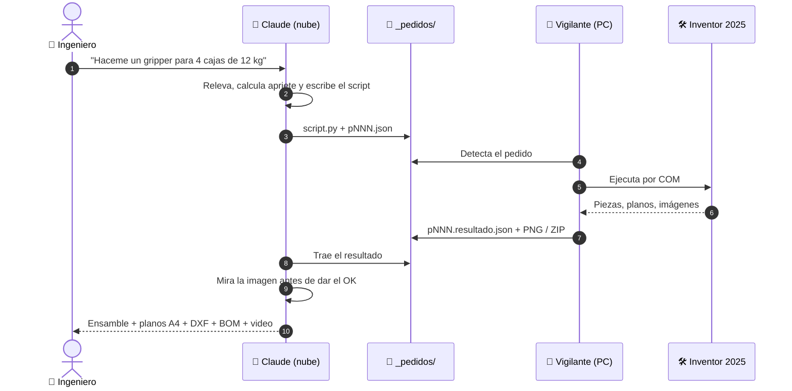
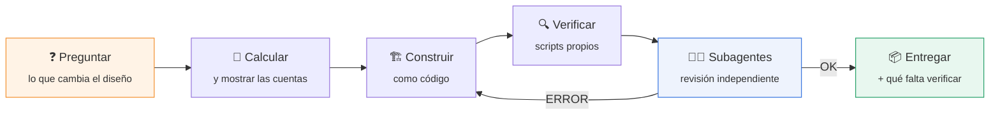
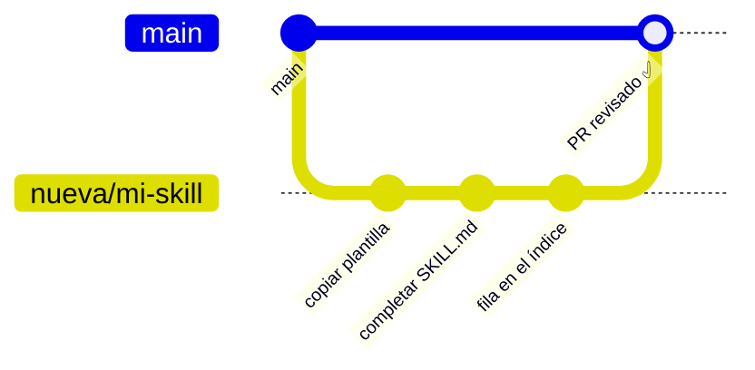

<div align="center">



<br>

[](#-automatizaciones)
[](#-skills-de-claude)
[](automatizaciones/inventoria/)
[](automatizaciones/inventoria/)
[](skills/crear-placa/)
[](#)

**Todo lo que ya le enseñamos a la IA, en un solo lugar.**<br>
Scripts, guías y skills para que cualquier persona del equipo reutilice lo que funciona en vez de empezar de cero.

[Qué hay](#-qué-hay-acá) · [Automatizaciones](#-automatizaciones) · [Skills](#-skills-de-claude) · [Empezar](#-empezar-en-3-pasos) · [Contribuir](docs/CONTRIBUIR.md)

</div>

---

## 🗺️ Qué hay acá



<table>
<tr>
<td width="25%" align="center" valign="top">
<a href="automatizaciones/inventoria/"></a><br>
<b><a href="automatizaciones/inventoria/">InventorIA</a></b><br>
<sub>Claude diseña, dibuja y simula en Inventor por script</sub>
</td>
<td width="25%" align="center" valign="top">
<a href="automatizaciones/ilogic-layout-paletizado/"></a><br>
<b><a href="automatizaciones/ilogic-layout-paletizado/">Layout de paletizado</a></b><br>
<sub>Regla iLogic que arma la celda entera con vista previa</sub>
</td>
<td width="25%" align="center" valign="top">
<a href="skills/armar-tablero-electrico/"></a><br>
<b><a href="skills/armar-tablero-electrico/">Tablero eléctrico</a></b><br>
<sub>Potencia, protecciones, BOM en Drive y revisión</sub>
</td>
<td width="25%" align="center" valign="top">
<a href="skills/crear-placa/"></a><br>
<b><a href="skills/crear-placa/">Crear placa</a></b><br>
<sub>PCB en KiCad 7 como código, sin pistas a 90°</sub>
</td>
</tr>
</table>

---

## ⚙️ Automatizaciones

| | Nombre | Qué hace | Herramientas | Estado |
|:-:|---|---|---|:-:|
|  | **[InventorIA](automatizaciones/inventoria/)** | Diseño paramétrico en Inventor (grippers, rejas, estructuras), planos A4/DXF, BOM y animaciones de celdas KUKA cuadro a cuadro, todo por script manejado por IA | Inventor 2025 · Python 3.13 · pywin32 · ffmpeg | ✅ En uso |
|  | **[Layout de paletizado](automatizaciones/ilogic-layout-paletizado/)** | Regla iLogic con ventana de configuración y vista previa: ubica robot, cintas, pallets, máquinas, vallado y puerta, y avisa si algo queda fuera de alcance o excede la carga | Inventor 2025 · iLogic (VB.NET) | 🧪 En prueba |

### Cómo trabaja InventorIA



---

## 🧠 Skills de Claude

Una **skill** es un `SKILL.md` que le enseña a Claude un procedimiento completo. Se carga una vez y Claude la usa sola cuando el pedido coincide.

| | Skill | Se dispara cuando pedís… | Entrega |
|:-:|---|---|---|
|  | [`inventoria`](skills/inventoria/SKILL.md) | algo en Inventor, un gripper, planos o una simulación | Modelos, planos y videos en `Generados\` |
|  | [`armar-tablero-electrico`](skills/armar-tablero-electrico/SKILL.md) | el tablero de un equipo o biorreactor | Presupuesto de potencia, protecciones, BOM en Drive, diagramas y notas de armado |
|  | [`crear-placa`](skills/crear-placa/SKILL.md) | una placa PCB desde especificaciones | Proyecto KiCad 7, Gerber/BOM/CPL, esquemático PDF y diagramas |

Las tres siguen el mismo método:



---

## 🚀 Empezar en 3 pasos

<table>
<tr>
<th width="33%">1 · Elegí</th>
<th width="33%">2 · Cargá</th>
<th width="33%">3 · Pedí</th>
</tr>
<tr valign="top">
<td>

Buscá en las tablas de arriba la automatización o skill que te sirve y entrá a su carpeta.

</td>
<td>

**Skill:** comprimí la carpeta `skills/<nombre>/` en un .zip y cargala en Claude como skill.<br>
**Automatización:** leé su `README.md` y seguí *Cómo arrancar*.

</td>
<td>

Hablale a Claude normal: *"armame el tablero del biorreactor 2"*. Revisá las listas de control antes de entregar.

</td>
</tr>
</table>

---

## 📁 Estructura

```text
IA/
├── 📄 README.md                    ← estás acá
├── 🎨 assets/                      banner e íconos del README
├── ⚙️ automatizaciones/
│   ├── inventoria/                 InventorIA completo (instalador, scripts, guías)
│   │   ├── README.md               ficha
│   │   ├── CLAUDE.md               instrucciones que lee la IA
│   │   ├── INSTALACION.md          paso a paso en una PC nueva
│   │   ├── GUIA.pdf                guía maestra impresa
│   │   ├── docs/                   guía, simulaciones, índice de scripts, historial
│   │   └── inventor-assistant-portable/   server/ + scripts/ + vigilante
│   └── ilogic-layout-paletizado/
│       ├── Generador_Layout_Paletizado.vb
│       ├── Biblioteca_Layout.ejemplo.txt
│       └── ejemplos/
├── 🧠 skills/
│   ├── inventoria/SKILL.md
│   ├── armar-tablero-electrico/SKILL.md
│   └── crear-placa/SKILL.md
├── 📋 plantillas/                  ficha de automatización + SKILL.md base
└── 📚 docs/                        convenciones y cómo contribuir
```

---

## 📏 Convenciones de la casa

| | |
|---|---|
| 🗣️ **Idioma** | Español rioplatense, mensajes cortos |
| 📐 **Unidades** | mm · hojas A4 · DXF 1:1 |
| 🛡️ **Originales** | Nunca se tocan: se trabaja sobre copias |
| ✏️ **Cambios** | Editar lo que existe, no regenerar |
| 🔬 **Pruebas** | Primero en chico: 1 imagen → 1 cuadro → render completo |
| 👁️ **Verificación** | Nada está "listo" sin haberlo mirado |

Detalle en [docs/convenciones.md](docs/convenciones.md).

---

## 🤝 Contribuir



Reglas rápidas: **nada de archivos de clientes** (`.ipt`, `.iam`, `.idw`, `.dwg`, planos reales), **nada de secretos** y **nada pesado o generado** (zips, MP4, `Generados/`). Todo el detalle en **[docs/CONTRIBUIR.md](docs/CONTRIBUIR.md)**.

**Estados:** ✅ En uso · 🧪 En prueba · 📝 Borrador · 🗄️ Archivada

---

> [!WARNING]
> Los cálculos que generan estas herramientas (retención, estructura, neumática, carga del robot, protecciones eléctricas) son **preliminares**. Los aprueba un ingeniero responsable antes de fabricar.

<div align="center">
<sub>Hecho en Argentina 🇦🇷 por <b>DEFYMOTION</b> · robótica y paletizado</sub>
</div>
