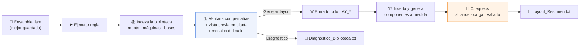
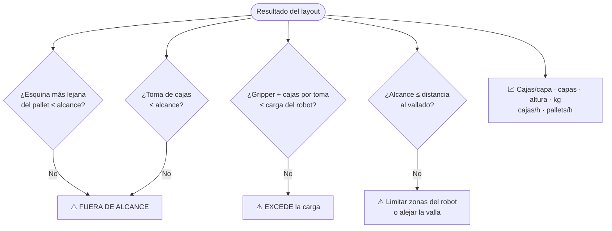

<div align="center">


# Generador de layout de paletizado

**Una regla iLogic que arma la celda de paletizado completa —robot, línea, pallets, máquinas y vallado— desde una ventana con vista previa en vivo.**


</div>

| | |
|---|---|
| **Qué hace** | Genera el layout preliminar de una celda de paletizado en un ensamble de Inventor y verifica alcance, carga y producción |
| **Para quién** | Ingeniería comercial y diseño (cotizaciones y anteproyectos) |
| **Estado** | 🧪 En prueba |
| **Responsable** | _completar_ |
| **Versión** | 3 · 21 de octubre de 2026 |

---

## 🧭 Flujo



**Convención:** robot en `(0,0,0)`, X a la derecha, Y hacia atrás, Z arriba, en mm. Todo se ubica por **caja envolvente**, sin depender del origen de cada modelo; el robot se endereza y se ancla en su base.

---

## 🧱 Qué arma

| Grupo | Componentes | De dónde salen |
|---|---|---|
| 🤖 **Robot** | Robot, base, gripper | Biblioteca (detecta robots solos) o base/gripper generados |
| 🛤️ **Línea** | 1–2 estaciones, tramos de vacío y salida, transportadores de rodillos | Generados a medida |
| 📥 **Entrada** | 1–2 cintas, tope o freno de cajas | Generados a medida |
| 📦 **Producto** | Pallets y cajas de ejemplo con mosaico *Columnar / Trabado / Mixto / Auto*, cartón entre capas | Generados a medida |
| 🏭 **Máquinas** | Dispenser de pallets, centrador, envolvedora, mesa de cartón, tablero eléctrico | Biblioteca |
| 🚧 **Vallado** | Paneles perimetrales y puerta | Generados a medida |

**Presets incluidos** — Cajas: 400×300×250, 600×400×300, 500×350×300, bolsas… · Pallets: ARLOG 1200×1000, Europeo 1200×800, Americano 1219×1016, medio pallet, industrial 1200×1200.

### Chequeos automáticos



Ejemplo real de salida en [`ejemplos/Layout_Resumen.txt`](ejemplos/Layout_Resumen.txt):

```text
Pallet 1200x1000  caja 500x350x300  patron Columnar
6 cajas/capa x 5 capas = 30 cajas/pallet | altura 1644 mm | 385 kg
Ciclo 8,0 s -> 450 cajas/h -> 15,0 pallets/h
Carga por toma 72 kg / robot 25 kg (estimado) -> EXCEDE
```

---

## 🚀 Cómo arrancar

1. Copiá `Generador_Layout_Paletizado.vb` como **regla externa de iLogic** (por ejemplo en `C:\<tu carpeta>\Reglas iLogic\`).
2. Copiá `Biblioteca_Layout.ejemplo.txt` al lado de la regla como **`Biblioteca_Layout.txt`** y cambiá `RAIZ` por la carpeta donde tenés tus modelos CAD.
3. En la regla, ajustá `CARPETA_CAD` (al principio de `Sub Main`) o dejala en `""` para que la pregunte la primera vez y la recuerde.
4. Abrí o creá un ensamble `.iam` (mejor guardado), ejecutá la regla, configurá en la ventana y tocá **Generar layout**.
5. Si un modelo no aparece o sale acostado, corré el modo **Diagnóstico** y corregí con `ORIENT_<máquina>` / `MAQUINA_<nombre>` en la biblioteca.

### Biblioteca (`Biblioteca_Layout.txt`)

| Clave | Ejemplo | Para qué |
|---|---|---|
| `RAIZ` | `C:\CAD\Biblioteca` | Carpeta(s) donde se buscan los modelos |
| `EXCLUIR` | `OldVersions;Templates` | Subcarpetas que se ignoran |
| `BASE_ROBOT` | `Ensamble base.iam` | Base por defecto |
| `PALLET`, `CAJA`, `VALLA`… | `GENERAR` | Generar a medida en vez de buscar archivo |
| `ORIENT_<máquina>` | `rotX=90` | Corrige modelos acostados o girados |
| `MAQUINA_<nombre>` | `archivo.iam` | Agrega o reemplaza una máquina |
| `ROBOT_<nombre>` | `archivo.iam` | Agrega un robot |

---

## 📚 Contenido

| Archivo | Para qué |
|---|---|
| `Generador_Layout_Paletizado.vb` | La regla iLogic (VB.NET, ~4.500 líneas) |
| `Biblioteca_Layout.ejemplo.txt` | Configuración de la biblioteca de modelos |
| `ejemplos/Layout_Resumen.txt` | Resumen de una corrida real con avisos |

> [!NOTE]
> Las piezas `LAY_*.ipt`, miniaturas, caché de medidas y logs se regeneran solos en `LAY_Generados\` al lado del ensamble; **no se suben al repositorio**.

## ⚠️ Limitaciones y avisos

- Todo lo que empieza con `LAY_` en el ensamble **se borra y se regenera** en cada corrida.
- La carga y el alcance "según modelo" se estiman por el nombre del robot; si el resumen dice *(estimado)*, cargá el dato real en la pestaña **Robot**.
- Conocido: con algunos robots Borunte la inserción falla con `E_INVALIDARG` (ver el resumen de ejemplo).
- Es un **anteproyecto**: distancias de seguridad y vallado se validan con la normativa antes de fabricar.

## 🕓 Historial

| Versión | Fecha | Cambio |
|---|---|---|
| 3 | 2026-10-21 | Ventana con pestañas y vista previa en vivo, chequeos de alcance/carga, modo Diagnóstico |
