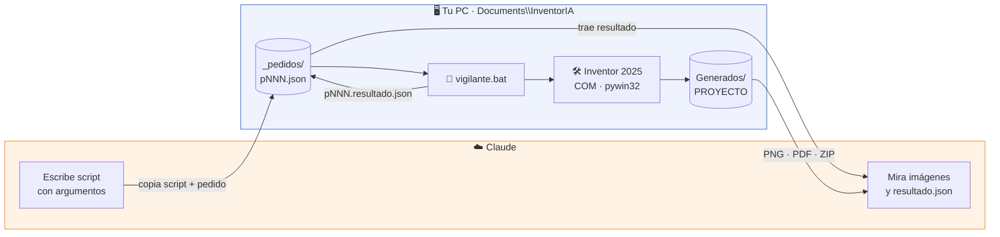
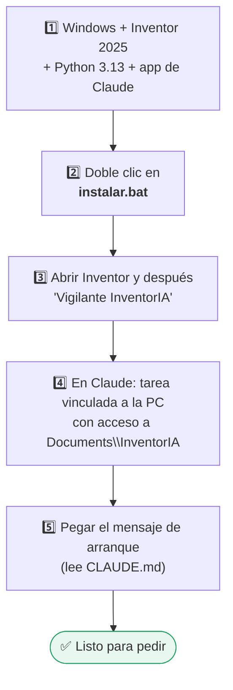
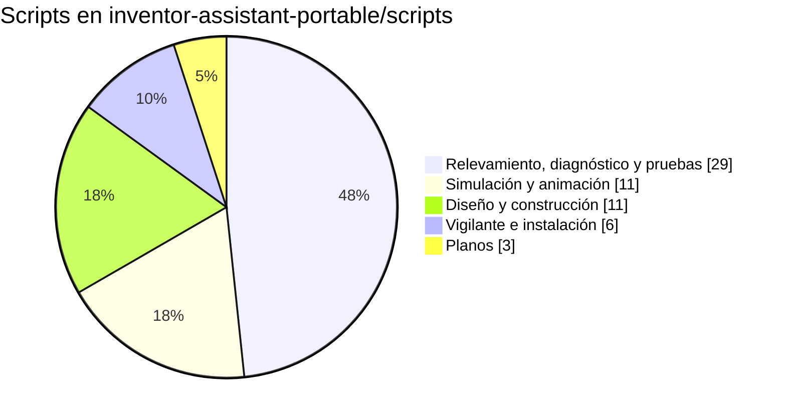

# InventorIA

**Claude maneja Autodesk Inventor por script: diseña, dibuja planos y simula celdas robotizadas.**

| | |
|---|---|
| **Qué hace** | Piezas y ensambles paramétricos (grippers, rejas, estructuras), planos A4, DXF de corte, listas de materiales y animaciones de celdas KUKA cuadro a cuadro |
| **Para quién** | Ingeniería y diseño mecánico |
| **Estado** | ✅ En uso |
| **Responsable** | _completar_ |
| **Versión** | 1.1 · 21 de octubre de 2026 |

---

## 🧩 Cómo funciona

Inventor corre en tu PC. Claude no lo toca directamente: deja **pedidos** (scripts Python) en una carpeta y un programa chico, el **vigilante**, los ejecuta en tu Inventor y le devuelve los resultados.

> Si Claude corre **en la misma PC** (Claude Code con terminal en Windows) no hace falta el vigilante: ejecuta `.venv\Scripts\python.exe scripts\<script>.py` directo.

---

## 📦 Entregables

| | Entregable | Formato | Dónde queda |
|:-:|---|---|---|
| 🦾 | Piezas de chapa y ensambles con restricciones | `.ipt` `.iam` | `Generados\<PROYECTO>\` |
| 📐 | Planos A4 de chapas y conjunto | `.dwg` + `.pdf` | ídem |
| ✂️ | DXF de corte 1:1 por chapa | `.dxf` | ídem |
| 📋 | BOM con fórmulas (piezas, caños, herrajes, bulonería) | `.xlsx` | ídem |
| 🎬 | Video de la celda funcionando, horizontal o vertical | MP4 Full HD | ídem |

---

## 🚀 Inicio rápido

> Detalle completo en **[INSTALACION.md](INSTALACION.md)** (unos 30 minutos).

1. Tener **Windows + Autodesk Inventor 2025** con licencia, **Python 3.13** (no el alias de la Microsoft Store) y la **app de escritorio de Claude**.
2. Clonar o bajar este repositorio, entrar a `automatizaciones/inventoria/` y ejecutar **`instalar.bat`**. Crea `Documents\InventorIA`, copia todo e instala las dependencias.
3. Abrir **Inventor** y después el acceso directo **"Vigilante InventorIA"** del escritorio. Dejar las dos ventanas abiertas.
4. En la app de Claude, abrir una tarea **vinculada a esta computadora** con acceso a `Documents\InventorIA`.
5. Pegar el mensaje de arranque de [INSTALACION.md §6](INSTALACION.md#6-primer-mensaje-a-claude).
6. Antes de cualquier trabajo caro: **relevamiento + una imagen de prueba aprobada**.

---

## 📚 Contenido

| Ruta | Qué es |
|---|---|
| [`CLAUDE.md`](CLAUDE.md) | 🤖 **Instrucciones para la IA**: reglas, protocolo del vigilante y por dónde empezar. La IA lo lee primero |
| [`INSTALACION.md`](INSTALACION.md) | 🧰 Instalación paso a paso y conexión con Claude |
| [`GUIA.pdf`](GUIA.pdf) | 📕 Guía maestra para imprimir |
| [`docs/Guia_IA_Inventor.md`](docs/Guia_IA_Inventor.md) | 📘 **Guía maestra**: método completo de diseño, planos y animaciones |
| [`docs/SIMULACIONES.md`](docs/SIMULACIONES.md) | 🎬 Receta para simulaciones y videos (comandos, tiempos, variantes) |
| [`docs/SCRIPTS.md`](docs/SCRIPTS.md) | 🗂️ Índice de todos los scripts |
| [`docs/Receta_IA_Inventor.md`](docs/Receta_IA_Inventor.md) | 🧪 Receta técnica original (API de Inventor, planos, robots) |
| [`docs/InventorIA_contexto.md`](docs/InventorIA_contexto.md) | 🕓 Historial y estado de cada proyecto |
| `inventor-assistant-portable/server/` | 🐍 Librería de Inventor por COM (`inventor_mcp.py`) y motor de grippers (`gripper_design.py`, `gripper_calc.py`) |
| `inventor-assistant-portable/scripts/` | ⚙️ Un script por tarea + `vigilante.py` / `.bat` + `verificar_instalacion` |
| `instalar.bat` / `instalar.ps1` | 💾 Instalador para una PC nueva |
| `plantillas/pedido_ejemplo.json` | 📝 Formato de un pedido para el vigilante |

### Scripts por familia

Ver la lista completa con descripción en **[docs/SCRIPTS.md](docs/SCRIPTS.md)**.

---

## 🏆 Reglas de oro

| # | Regla | Por qué |
|:-:|---|---|
| 1 | 🛡️ **Nunca tocar originales** — copias o `Generados\` | Los modelos del cliente no se pueden romper |
| 2 | ✏️ **Editar, no regenerar** — en videos, re-renderizar sólo el tramo que cambia | Ahorra horas de render y tokens |
| 3 | 📜 **Todo por script** con argumentos y `resultado.json` | Repetible y auditable |
| 4 | 📏 **Medir antes de suponer** y mirar la imagen antes de decir que funciona | La IA no "ve" Inventor si no le mostrás |
| 5 | 🔬 **Probar en chico**: 1 foto → 1 cuadro → tramo → render completo | Los errores caros se ven en la primera foto |

---

## ⚠️ Limitaciones y avisos

> [!CAUTION]
> **No usar `AnalyzeInterference` durante una simulación**: cierra Inventor.

- La API de Inventor 2025 no permite crear presentaciones (`.ipn`): las animaciones se hacen cuadro a cuadro y se arman con `ffmpeg`.
- No abrir Inventor "como administrador": la conexión COM falla (`MK_E_UNAVAILABLE` / `0x80080005`).
- **Modelos CAD no incluidos** (layouts de clientes, robots, comerciales). Las simulaciones con KUKA KR 140 necesitan el ensamble del robot del servidor de proyectos; ver [INSTALACION.md §7](INSTALACION.md#7-modelos-cad-necesarios).
- Los cálculos son preliminares; los aprueba un ingeniero antes de fabricar.

---

## 🕓 Historial

| Versión | Fecha | Cambio |
|---|---|---|
| 1.1 | 2026-10-21 | Repositorio completo (instalador, scripts, docs) integrado en `automatizaciones/inventoria/` |
| 1.0 | 2026-10-07 | Primera versión de la guía maestra |
