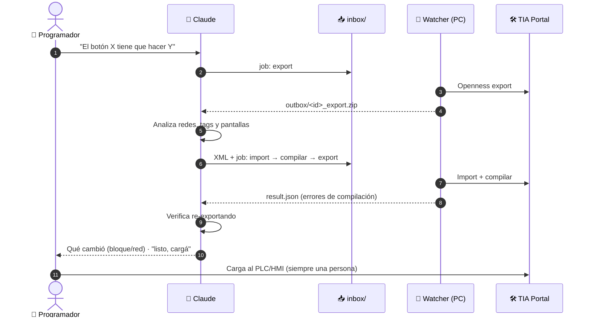

# PLC IA

**Claude lee y modifica programas de PLC y HMI por XML, a través de un watcher que maneja TIA Portal por Openness.**

**Qué hace:** exporta el proyecto a XML, Claude lo analiza, genera los cambios (redes LAD, DBs, tags, pantallas HMI), los importa, compila y verifica re-exportando. Todo sin correr scripts a mano.
**Para quién:** programación de PLC / puesta en marcha.
**Estado:** 🧪 En prueba (el flujo con scripts sueltos ✅ en uso en un paletizador S7-1500 + KUKA; el watcher es nuevo)
**Responsable:** Lautaro
**Versión:** 1.0 · 2026-11-26

## Cómo trabaja

## Requisitos
- TIA Portal V17 (otras versiones: cambiar la DLL en `config.json`) con Openness instalado.
- Usuario de Windows en el grupo **Siemens TIA Openness**.
- Windows PowerShell 5.1 (viene con Windows).
- Claude con la carpeta `C:\PLC_Bridge` conectada (app de escritorio → + → Agregar carpeta).
- Opcional: EcoStruxure Machine Expert para el adaptador Schneider (beta).

## Cómo arrancar
1. Copiar `plc-bridge/` a `C:\PLC_Bridge` y revisar `config.json` (DLL, `proyectos_permitidos`).
2. Cargar la skill [`programacion-plc`](../../skills/programacion-plc/SKILL.md).
3. Abrir TIA con una **copia** del proyecto y doble clic en `INICIAR_WATCHER.cmd`.
4. En un chat de la app de escritorio, conectar `C:\PLC_Bridge` y pedirle a Claude el cambio.

## Contenido de la carpeta
| Archivo | Para qué |
|---|---|
| `GUIA.md` | Instalación, acciones del watcher y protocolo de trabajos |
| `plc-bridge/watcher.ps1` | Mira `inbox\`, ejecuta los pasos, escribe `outbox\` |
| `plc-bridge/adapters/siemens_tia.ps1` | Openness: info, export, import, compile, save |
| `plc-bridge/adapters/schneider_me.ps1` | Machine Expert por `--noui --runscript` (beta) |
| `plc-bridge/lib/analizar.py` | Resumen de redes, cableado y búsqueda de símbolos |
| `plc-bridge/lib/tia_lad.py` | Genera redes LAD (FlgNet) e inserta en bloques exportados |
| `plc-bridge/ejemplos/` | Trabajos de ejemplo (`*.job.json`) |

## Limitaciones y avisos
- **No carga al PLC ni al panel**: eso lo hace una persona. Robots: probar en T1.
- Probado con S7-1500 y panel Comfort (WinCC Advanced). WinCC Unified no está cubierto.
- Schneider Machine Expert: beta, sin probar en planta. Control Expert (M340/M580) no tiene API: XEF/ZEF a mano.
- Trabajar siempre sobre copias del proyecto; `proyectos_permitidos` bloquea importar fuera de esa carpeta.

## Historial
| Versión | Fecha | Cambio |
|---|---|---|
| 1.0 | 2026-11-26 | Primera versión: watcher + adaptador TIA + Machine Expert beta + skill |
