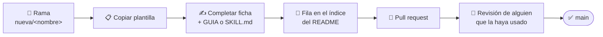

# 🤝 Cómo contribuir

¿Hiciste algo con Claude que funcionó? Subilo para que el resto no empiece de cero.

## Pasos

1. Creá una rama: `nueva/<nombre-corto>`.
2. Copiá la plantilla:
   - **Skill** → [`plantillas/skill/SKILL.md`](../plantillas/skill/SKILL.md) a `skills/<nombre>/SKILL.md`
   - **Automatización** → [`plantillas/ficha-automatizacion.md`](../plantillas/ficha-automatizacion.md) a `automatizaciones/<nombre>/README.md`
3. Completá la ficha y la guía (`GUIA.md`) o el `SKILL.md`.
4. Agregá la fila en el índice del [README principal](../README.md) (y en [`skills/README.md`](../skills/README.md) si es una skill).
5. Abrí un pull request y pedí revisión a alguien que la haya usado.

## Reglas para subir

| | Regla |
|:-:|---|
| 🚫 | **Nada de archivos de clientes**: ni modelos (`.ipt`, `.iam`, `.idw`, `.dwg`), ni layouts, ni PDFs de planos reales. Sólo scripts, guías y ejemplos anonimizados |
| 🔐 | **Nada de secretos**: contraseñas, API keys, rutas de servidores internos |
| 🪶 | **Nada pesado ni generado**: `.venv/`, `Generados/`, cuadros de video, zips, MP4. Subí las carpetas **descomprimidas** |
| 🔤 | Carpetas en minúscula y con guiones: `simulacion-celdas`, `bom-excel` |
| 📚 | Cada lección nueva (error + solución) se agrega a la guía de esa automatización |

El [`.gitignore`](../.gitignore) de la raíz ya bloquea lo más común.

## Estados

✅ En uso · 🧪 En prueba · 📝 Borrador · 🗄️ Archivada
