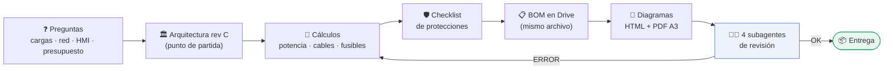
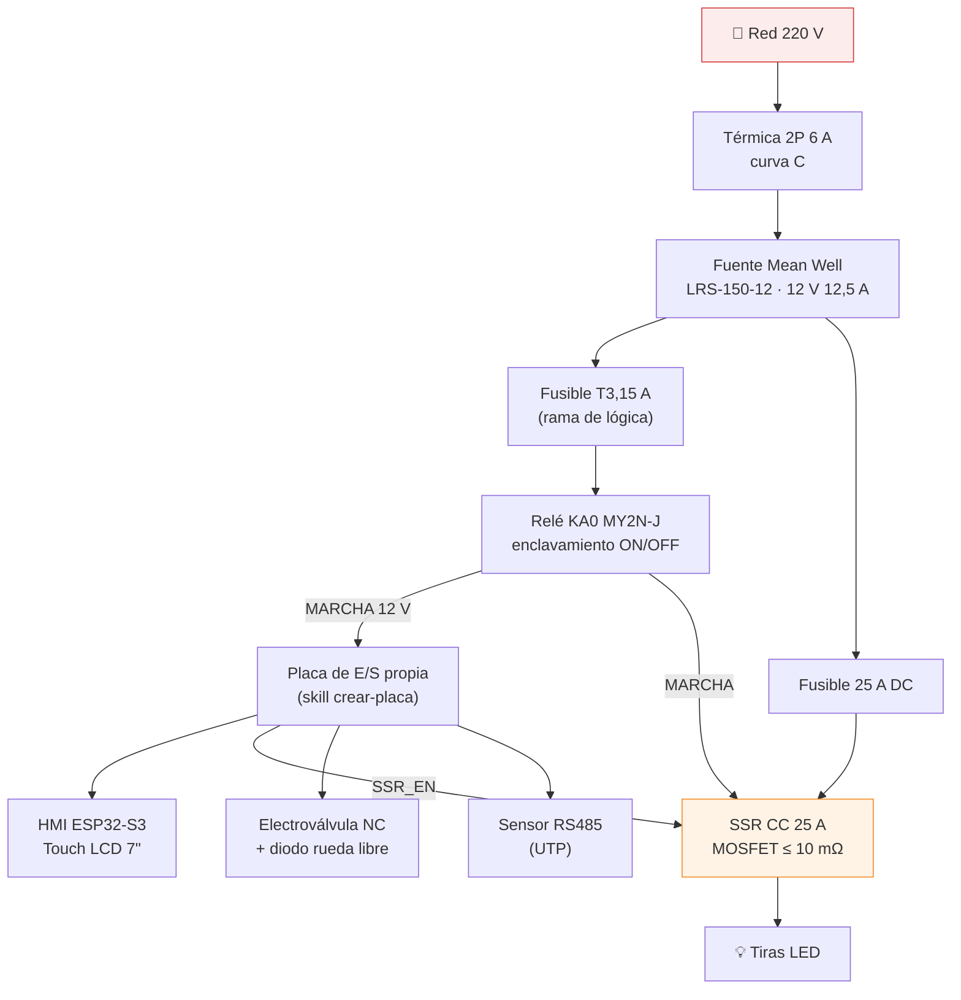

# Armar tablero eléctrico

**Del relevamiento a la lista de materiales y las notas de puesta en marcha, con revisión independiente.**

## 🧭 Flujo de la skill

## 🏛️ Arquitectura de referencia (rev C)

Un tablero por biorreactor, gabinete de ~300×300×150 mm.

## 🧑‍⚖️ Revisión independiente

| Subagente | Revisa |
|---|---|
| ⚡ Eléctrico / potencia | Cargas, cables, fusibles, selectividad, retorno, caídas |
| 🛡️ Seguridad / normativa | Térmica, diferencial, PE, bornes, separación 220 V / 12 V |
| 📋 Lista de materiales | Cantidades contra el esquema, estimados marcados, totales y fórmulas |
| 📝 Documentación | Consistencia de textos y diagramas con la revisión vigente |

Cada uno reporta **ERROR / MEJORA / OK** (máx. 500 palabras) y no edita nada.

## 📦 Entregables

- Presupuesto de potencia y cálculos visibles
- Lista de materiales en Google Sheets (precios estimados en amarillo, total y margen contra el tope)
- Esquema por capas, conexionado de la placa y de la HMI (página HTML + PDF A3 apaisado)
- Notas de armado y puesta en marcha paso a paso

> [!IMPORTANT]
> La skill edita **siempre el mismo archivo** de Drive y confirma la fila antes de escribir. Necesita el conector de Google Drive / Sheets.

👉 Instrucciones completas en **[SKILL.md](SKILL.md)**.
