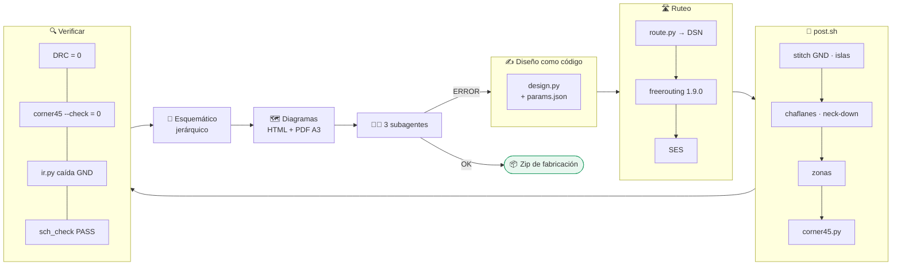

# Crear placa

**PCB en KiCad 7 como código: netlist en Python, autoruteo, chaflanes a 45° y tres revisores independientes.**

> [!IMPORTANT]
> **Regla fija:** ninguna pista a 90° en ninguna placa. Sólo chaflanes de 45°, incluidas las uniones en T.

## 🧭 Pipeline

## 📏 Reglas de fabricación (JLCPCB, 2 capas)

| Parámetro | Mínimo |
|---|---|
| Ancho de pista | 0,15 mm |
| Separación | 0,15 mm (clase 0,2) |
| Vía | 0,6 / 0,3 mm |
| Agujero | 0,3 mm |
| Cobre al borde | 0,3 mm |

## 🧑‍⚖️ Revisión independiente

| Subagente | Revisa |
|---|---|
| ⚡ Eléctrico | Huérfanos, corriente por borne, strapping pins, ADC, protecciones, retorno único, niveles 3,3/5 V |
| 🛣️ Ruteo | Ángulos de 90° con script propio, DRC, plano de GND, pistas de potencia, antena, USB |
| 🏭 Disposición y fabricación | Ubicación, montaje, serigrafía, Gerber/BOM/CPL, esquemático ↔ placa |

## 📦 Entrega

`kicad/` (pcb, pro, sch) · `fab/` (Gerber, BOM, CPL) · esquemático PDF · vista PNG · notas de armado · scripts — y una lista clara de **qué quedó sin verificar**.

👉 Instrucciones completas en **[SKILL.md](SKILL.md)**.
